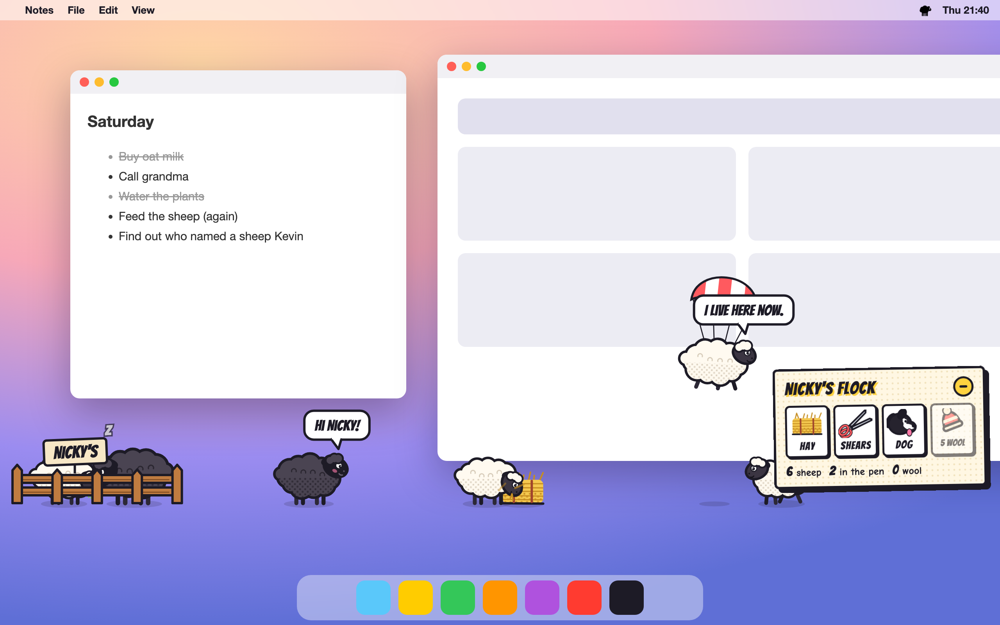
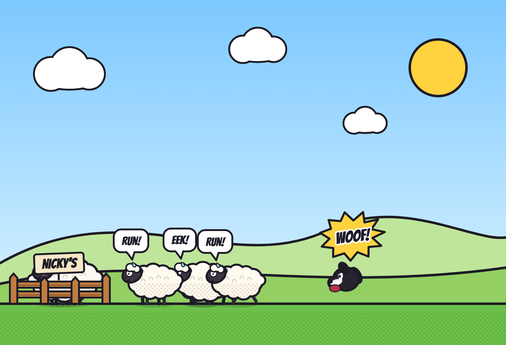

# Nicky's Flock

**Enterprise-grade ovine workload orchestration for the modern desktop.**




Nicky's Flock deploys a horizontally scalable fleet of comic sheep to the bottom edge of your primary display. Sheep are provisioned on a configurable schedule via parachute, walk-in or spontaneous materialisation, and are retired when they get too hungry. It was built for one user, Nicky, who has since been promoted to Head of Flock.

**Download:** [flock.doordarius.nl](https://flock.doordarius.nl) or the [latest release](https://github.com/dariusrosendahl/nickys-flock/releases/latest).

## Features

| Capability | Implementation |
| --- | --- |
| Sheep provisioning | Parachute (45%), walk-in from the right (33%), `POP!` (22%) |
| Load balancing | One sheepdog. Sheep move away from it. |
| Persistent storage | The pen. Sheep inside it never leave. |
| Feeding | Hay bales, 5 concurrent, about 20 seconds of munching each |
| Revenue | Shearing yields 1 to 3 wool depending on fleece utilisation |
| Upsell | Knitted bobble hat, 5 wool, 5 colourways |
| Observability | Hover a sheep for name, hunger and wool level |
| Disaster recovery | The flock is saved to disk and restored on launch, hats included |
| Alerting | Synthesized baa. Can be muted. |
| Focus management | The overlay is never focusable. Your keyboard stays yours. |
| Compliance | Signed and notarized on macOS. On Windows it has a good personality. |



## Architecture

```
menu bar / tray
      │
      ▼
main.js ── one transparent, always-on-top, click-through window over the work area
      │      polls the cursor at 30 Hz, toggles click-through when you point at a sheep
      ▼
renderer/
  art.js     every sheep, hat, hay bale and sheepdog, drawn with canvas paths (no image files)
  game.js    the flock: physics, moods, hunger, wool growth, herding, saving
  sound.js   baas, snips, munches and woofs, synthesized with Web Audio
```

No sheep were rasterised in the making of this software.

## Run it

```sh
pnpm install
pnpm start          # sheep on your actual screen
pnpm selftest       # headless: renders two scenes to /tmp, exits 1 on console errors
```

The renderer also runs in a browser without Electron: open `renderer/index.html?preview` for a meadow of its own, or `?preview&demo=herd|feed|shear|desk` for the screenshot scenes.

## Build

```sh
pnpm icons                      # app icon, tray icons, page sprites
./scripts/release.sh            # macOS universal DMG, signed + app notarized
./scripts/notarize-dmg.sh       # sign, notarize and staple the DMG itself
pnpm dist:win                   # Windows NSIS installer (x64), unsigned
pnpm shots && pnpm site:build   # screenshots + download page in site/
```

The macOS scripts expect a Developer ID key and certificate and an App Store Connect API key on the build machine; see the variables at the top of each script.

## SLA

Sheep may baa at any time. Sheep may stand in front of your Save button. Sheep left outside the pen while starving may leave for greener desktops. None of this is covered.

## Licence

MIT for the code. The fonts (Bangers, Comic Neue) are under the SIL Open Font License.

Made for Nicky by Darius.
